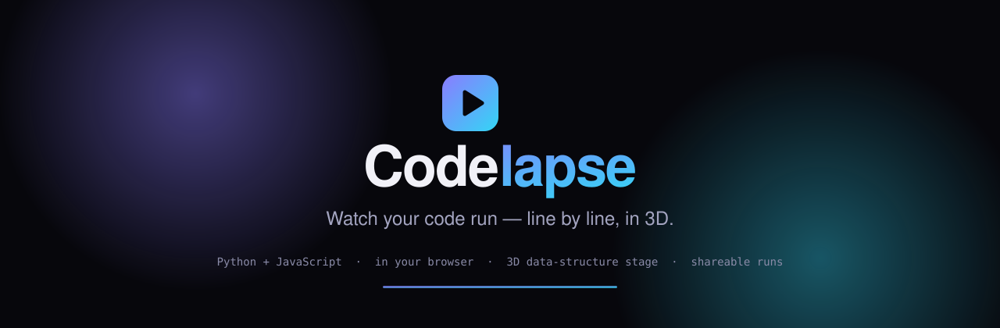

<div align="center">



<br/>

**Paste code, press <kbd>▶</kbd>, and watch every line execute** — with live variables, printed
output, a control‑flow graph, and a **3D stage** where arrays, stacks and dicts move as physical objects.

<br/>

[](LICENSE)
[](tsconfig.json)
[](vite.config.ts)
[](#-how-it-works)
[](#-contributing)

**[▶ Live demo](https://codelapse.vercel.app)** &nbsp;·&nbsp; [Architecture](docs/PLAN.md) &nbsp;·&nbsp; [Roadmap](#-roadmap)

<sub>Live demo link goes live once deployed on Vercel.</sub>

</div>

---

## ✨ What it is

Codelapse is a **visual dry run** of code for students and self‑taught developers. Instead of
guessing what your program does, you *watch* it happen:

- the current **line** highlights as it runs
- **variables** update, flashing `old → new` when they change
- **output** builds up as it prints
- the **control‑flow** lights the active branch
- a **3D WebGL stage** animates your data structures — an element flies into an array, a key drops into a dict, boxes pulse when a value changes

…and it plays back like a video: step forward/back, scrub the timeline, pick a speed. It runs
**entirely in your browser** — nothing you type is ever uploaded.

> 📸 _Drop a screenshot or GIF of the playground here — run `npm run dev`, then use the in‑app **Share → Download GIF**._

---

## 🧩 Features

| | |
|---|---|
| 🎬 **Video‑style playback** | Play / pause, step, scrub, speed (1×–16×), jump to the next variable change |
| 🧊 **3D data‑structure stage** | Arrays, dicts, sets and strings as physical objects (Three.js) — with a 2D fallback |
| 🐍 **Python** + 🟨 **JavaScript** | Both traced **in the browser** (Pyodide / AST‑instrumentation) — Java, C, C++ are on the roadmap |
| 🔗 **Shareable runs** | A link replays the exact run, or opens your code behind a press‑play gate — plus a QR code |
| 🎞️ **GIF export** | Turn any run into a shareable clip, client‑side |
| 🎨 **Bold, alive UI** | Dark glass, gradient accents, brand syntax highlighting, a first‑run tour |
| ♿ **Accessible** | Keyboard‑driven, focus rings, reduced‑motion aware, screen‑reader output |
| 🔒 **Safe by design** | User code runs in a **network‑stripped Web Worker** — no `fetch`, even from a shared link |

---

## ⚡ How it works

One idea powers everything: **run the code once, record a trace, then just *walk* the trace.**

```
Editor ──Run──▶ Web Worker (tracer) ──▶ steps[]  ──▶  Playback clock
                                          │                 │
                 a per-step snapshot of   │      ┌──────────┼───────────┬────────────┐
                 line · vars · stack ·    │      ▼          ▼           ▼            ▼
                 stdout, all precomputed  │   editor    variables    output     3D stage
```

Because playback is just indexing into a precomputed array, **stepping backward is free** and
the timeline scrubs instantly. Every language emits the *same* trace shape, so the whole player is
language‑agnostic.

**Two tiers, one UI:** Python & JS/TS trace **in the browser** (free, safe, zero backend). Compiled
languages (Go, Java, C/C++) are a later **server tier** — they have no in‑browser tracer, so they run
in a hardened sandbox. See [docs/PLAN.md](docs/PLAN.md).

---

## 🚀 Quick start

```bash
git clone git@github.com:RskOO7/Codelapse.git
cd Codelapse
npm install
npm run dev          # → http://localhost:5173
```

The Python engine (Pyodide) streams from a pinned CDN on first run and is cached after.

**Scripts**

| Command | What it does |
|---|---|
| `npm run dev` | Vite dev server |
| `npm run build` | Type‑check + production build → `dist/` |
| `npm run test` | Vitest suite |
| `npm run lint` | ESLint |
| `npm run format` | Prettier |

---

## ⌨️ Keyboard shortcuts

| Key | Action | Key | Action |
|---|---|---|---|
| <kbd>Space</kbd> | Play / pause | <kbd>←</kbd> <kbd>→</kbd> | Step back / forward |
| <kbd>Shift</kbd>+<kbd>←</kbd>/<kbd>→</kbd> | Jump to prev/next change | <kbd>Home</kbd> <kbd>End</kbd> | First / last step |
| <kbd>,</kbd> <kbd>.</kbd> | Slower / faster | <kbd>Esc</kbd> | Close dialog |

*(Active only when the editor isn't focused.)*

---

## 🛠️ Tech stack

**Vite** · **React** · **TypeScript** (strict) · **CodeMirror 6** · **Pyodide** (Python→WASM) ·
**Three.js / react‑three‑fiber** · **Zustand** · **acorn** (JS tracer) · **lz‑string** · **gifenc**.

Fully static, no backend, no database, no environment variables.

---

## ☁️ Deploy (Vercel)

The browser tier is a static site — it deploys to Vercel with **zero config**
([`vercel.json`](vercel.json) pins the Vite preset, `dist` output, and asset caching):

1. **Import** this repo at [vercel.com/new](https://vercel.com/new) → Deploy. That's it.
2. Or via CLI: `npm i -g vercel && vercel --prod`.

Every push to `main` auto‑deploys. No secrets, no serverless functions.

---

## 🗺 Roadmap

- [x] Python tracer + full playback UI
- [x] 3D WebGL data‑structure stage
- [x] Shareable runs (replay / press‑play) + GIF export
- [x] JavaScript tracer (in‑browser)
- [x] Design system, first‑run tour, custom UI
- [ ] TypeScript, more seed examples (placement‑prep set)
- [ ] Cinema mode · command palette · scrubber tooltips
- [ ] **Server tier** — Go, Java, C/C++ in a sandbox (demand‑gated)

---

## 🤝 Contributing

Issues and PRs are welcome. `npm run build && npm test && npm run lint` should pass; CI runs
type‑check, lint, format, tests and build on every push
([`.github/workflows/ci.yml`](.github/workflows/ci.yml)).

---

## 📄 License

[Apache‑2.0](LICENSE) — see [NOTICE](NOTICE) for third‑party licenses (Pyodide, CodeMirror, Three.js, …).

<div align="center"><sub>Built with ▶ and a lot of <code>console.log</code>.</sub></div>
